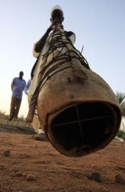

# Wazza gourd trumpet

*Wazza*

**Encyclopedia ID 1399** (permanent) · https://bpupadhyaya.github.io/world-heritage-games-site/games/1399-wazza-gourd-trumpet/

*Photo: Alzain Mohammed, [CC BY-SA 4.0](https://creativecommons.org/licenses/by-sa/4.0/), [source on Wikimedia Commons](https://commons.wikimedia.org/wiki/File:%D8%A2%D9%84%D8%A9_%D9%85%D9%88%D8%B3%D9%8A%D9%82%D9%8A%D8%A9.jpg)*

Blow into long gourd horns and match pitch pulses with other players in harvest ensemble.

## Heritage note

Part of the living heritage of Sudan. Some forms of this practice carry deep meaning for the communities who keep it; here we describe the play and the craft only, with respect for its roots.

## Origins

A living tradition passed from person to person; it is not tied to a single dated origin. It belongs to the cultural world of Africa: Nile and the Horn.

## Facts

- **Where:** Sudan
- **Type:** Musical instruments
- **Family:** Wind instruments
- **Era:** [Living Traditions](../../eras/living/index.md)
- **Cradle:** [Africa: Nile and the Horn](../../cradles/africa-nile/index.md)
- **Region:** Middle East and North Africa

## Related entries

- [Khene](../../games/145-khene/index.md)
- [Mijwiz Double Clarinet](../../games/221-mijwiz-double-clarinet/index.md)
- [Mudhif reed-arch house](../../games/230-mudhif-reed-arch-house/index.md)
- [Lusheng](../../games/337-lusheng/index.md)
- [Launeddas Triple Pipe](../../games/400-launeddas-triple-pipe/index.md)
- [Rubboard zydeco rhythm](../../games/437-rubboard-zydeco-rhythm/index.md)

## Sources

- <https://commons.wikimedia.org/wiki/File:%D8%A2%D9%84%D8%A9_%D9%85%D9%88%D8%B3%D9%8A%D9%82%D9%8A%D8%A9.jpg>
- <https://en.wikipedia.org/wiki/Wazza>
