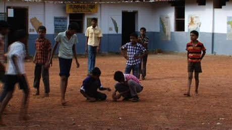

# Lagori

*Also known as: Pitthu · Dabba kali · Seven Stones · Satoliya*

**Encyclopedia ID 14** (permanent) · https://bpupadhyaya.github.io/world-heritage-games-site/games/14-lagori/

*Photo: Selvammk, [CC BY-SA 3.0](https://creativecommons.org/licenses/by-sa/3.0/), [source on Wikimedia Commons](https://commons.wikimedia.org/wiki/File:Lagori6.jpg)*

Knock down a tower of seven flat stones with a ball, then rebuild it before the other team hits you with the ball.

## Heritage note

A tradition shared by communities in many places.

## Origins

Usually placed in the era of Modern Heritage (1800 to today), although its exact origins are uncertain.

## Facts

- **Where:** India
- **Type:** Street and playground games
- **Family:** Archery and target games
- **Era:** [Modern Heritage](../../eras/modern/index.md) (uncertain)
- **Cradle:** [Shared across the world](../../cradles/worldwide/index.md)
- **Region:** South and Central Asia
- **Players:** 2 teams

## Play it

[Web preview](https://bpupadhyaya.github.io/) · [Google Play](https://play.google.com/store/apps/details?id=com.equalinformation.arcforge.shell) · [App Store](https://apps.apple.com/us/app/arcforge-world-heritage-games/id6813746442)

## Related entries

- [Pitch-pot](../../games/2-pitch-pot/index.md)
- [Jukskei](../../games/11-jukskei/index.md)
- [Tejo](../../games/57-tejo/index.md)
- [Bocce](../../games/830-bocce/index.md)
- [Kubb](../../games/1120-kubb/index.md)
- [Chilean Rayuela](../../games/1427-chilean-rayuela/index.md)

## Sources

- <https://commons.wikimedia.org/wiki/File:Lagori6.jpg>
- <https://en.wikipedia.org/wiki/Seven_stones>
- <https://en.wikipedia.org/wiki/Traditional_games_of_Nepal>
