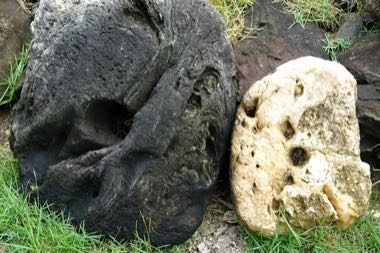

# Yap stone money trade puzzle

*Also known as: Rai*

**Encyclopedia ID 1401** (permanent) · https://bpupadhyaya.github.io/world-heritage-games-site/games/1401-yap-stone-money-trade-puzzle/

*Photo: Scot Nelson, [CC0](https://creativecommons.org/publicdomain/zero/1.0/), [source on Wikimedia Commons](https://commons.wikimedia.org/wiki/File:Yap_stone_money_2.jpg)*

Transport huge stone discs between villages by canoe, balancing weight and wind, trading ownership without moving the stone.

## Heritage note

Part of the living heritage of Micronesia.

## Origins

Usually placed in the era of Crossroads and Golden Ages (about 500 to 1500), although its exact origins are uncertain, within the cultural world of Pacific and Oceania.

## Facts

- **Where:** Micronesia
- **Type:** Board and table games
- **Era:** [Crossroads and Golden Ages](../../eras/crossroads/index.md) (uncertain)
- **Cradle:** [Pacific and Oceania](../../cradles/pacific/index.md)
- **Region:** Oceania and Pacific

## Related entries

- [Wayfinder](../../games/43-wayfinder/index.md)
- [Kōnane](../../games/961-konane/index.md)
- [Mu Torere](../../games/979-mu-torere/index.md)
- [Traditional contests at Micronesian Games](../../games/937-traditional-contests-at-micronesian-games/index.md)
- [Carolinian string figures](../../games/938-carolinian-string-figures/index.md)
- ['Ulu Maika](../../games/44-ulu-maika/index.md)

## Sources

- <https://commons.wikimedia.org/wiki/File:Yap_stone_money_2.jpg>
