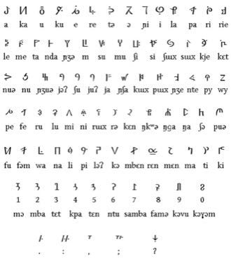

# Bamum script writer

*Shümom · Shümom syllabary*

**Encyclopedia ID 1405** (permanent) · https://bpupadhyaya.github.io/world-heritage-games-site/games/1405-bamum-script-writer/

*Photo: kwami (talk) Uploaded by Kwamikagami at en.wikipedia, [Public domain](https://creativecommons.org/publicdomain/mark/1.0/), [source on Wikimedia Commons](https://commons.wikimedia.org/wiki/File:Bamum_syllabary.png)*

Decode and write words with the Bamum syllabary, watching its signs simplify step by step from pictures to syllable characters.

## Heritage note

Part of the living heritage of Cameroon.

## Origins

A living tradition passed from person to person; it is not tied to a single dated origin. It belongs to the cultural world of Africa: Sahel, West and Central.

## Facts

- **Where:** Cameroon
- **Type:** Crafts and making
- **Family:** Folk and line dances
- **Era:** [Living Traditions](../../eras/living/index.md)
- **Cradle:** [Africa: Sahel, West and Central](../../cradles/africa-west/index.md)
- **Region:** Sub-Saharan Africa

## Related entries

- [Dabke line dance](../../games/37-dabke-line-dance/index.md)
- [Gumboot dance rhythm](../../games/123-gumboot-dance-rhythm/index.md)
- [Tahtib](../../games/157-tahtib/index.md)
- [Eskista](../../games/188-eskista/index.md)
- [Jebena coffee brewing](../../games/189-jebena-coffee-brewing/index.md)
- [Cueca](../../games/430-cueca/index.md)

## Sources

- <https://commons.wikimedia.org/wiki/File:Bamum_syllabary.png>
