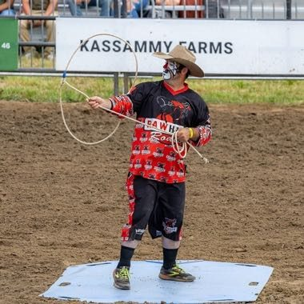

# Trick Roping

*Trick roping · Rope Spinning*

**Encyclopedia ID 1408** (permanent) · https://equalinformation.com/world-heritage-games-site/games/1408-trick-roping/

*Photo: Chris Woodrich, [CC BY-SA 4.0](https://creativecommons.org/licenses/by-sa/4.0/), [source on Wikimedia Commons](https://commons.wikimedia.org/wiki/File:Austin_Stewart_performing_trick_roping,_Kingsville_Pro_Rodeo,_Woodslee,_Ontario,_2025-07-26_02.jpg)*

The performer spins and shapes a loop of rope into patterns such as the flat loop, Texas skip and wedding cake, adding jumps through the loop.

## Heritage note

Part of the living heritage of United States.

## Origins

Usually placed in the era of Modern Heritage (1800 to today), although its exact origins are uncertain, within the cultural world of The Americas: North America.

## Facts

- **Where:** United States
- **Type:** Dexterity and skill games
- **Family:** Puzzle and dexterity toys
- **Era:** [Modern Heritage](../../eras/modern/index.md) (uncertain)
- **Cradle:** [The Americas: North America](../../cradles/north-america/index.md)
- **Region:** Americas

## Related entries

- [Square dance caller](../../games/129-square-dance-caller/index.md)
- [Cornhole](../../games/1194-cornhole/index.md)
- [Table shuffleboard](../../games/1199-table-shuffleboard/index.md)
- [Crokinole](../../games/623-crokinole/index.md)
- [Kingyo-sukui](../../games/3-kingyo-sukui/index.md)
- [Stone Skipping](../../games/5-stone-skipping/index.md)

## Sources

- <https://commons.wikimedia.org/wiki/File:Austin_Stewart_performing_trick_roping,_Kingsville_Pro_Rodeo,_Woodslee,_Ontario,_2025-07-26_02.jpg>
