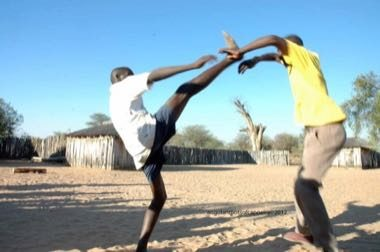

# Engolo

*N'golo · handstand kick duel*

**Encyclopedia ID 1409** (permanent) · https://equalinformation.com/world-heritage-games-site/games/1409-engolo/

*Photo: Matthias Röhrig Assunção, [CC BY-SA 4.0](https://creativecommons.org/licenses/by-sa/4.0/), [source on Wikimedia Commons](https://commons.wikimedia.org/wiki/File:Engolo-Angola.jpg)*

Two players circle to the music, dodging and sweeping with kicks from inverted positions, scoring when one is thrown off balance.

## Heritage note

Part of the living heritage of Angola.

## Origins

A living tradition passed from person to person; it is not tied to a single dated origin. It belongs to the cultural world of Africa: Southern Africa.

## Facts

- **Where:** Angola
- **Type:** Dances
- **Family:** Folk and line dances
- **Era:** [Living Traditions](../../eras/living/index.md)
- **Cradle:** [Africa: Southern Africa](../../cradles/africa-south/index.md)
- **Region:** Sub-Saharan Africa

## Related entries

- [Gumboot dance rhythm](../../games/123-gumboot-dance-rhythm/index.md)
- [Dabke line dance](../../games/37-dabke-line-dance/index.md)
- [Tahtib](../../games/157-tahtib/index.md)
- [Eskista](../../games/188-eskista/index.md)
- [Jebena coffee brewing](../../games/189-jebena-coffee-brewing/index.md)
- [Cueca](../../games/430-cueca/index.md)

## Sources

- <https://commons.wikimedia.org/wiki/File:Engolo-Angola.jpg>
