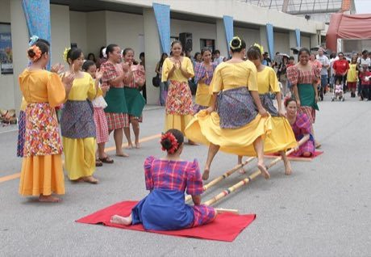

# Tinikling

*Tinikling · bamboo pole hop*

**Encyclopedia ID 141** (permanent) · https://bpupadhyaya.github.io/world-heritage-games-site/games/141-tinikling/

*Photo: U.S. Air Force / Senior Airman Nestor Cruz, [Public domain](https://creativecommons.org/publicdomain/mark/1.0/), [source on Wikimedia Commons](https://commons.wikimedia.org/wiki/File:Tinikling.jpg)*

Two bamboo poles are clapped together and apart to a beat while the dancer hops in and out between them.

## Heritage note

Part of the living heritage of Philippines.

## Origins

Usually placed in the era of Modern Heritage (1800 to today), although its exact origins are uncertain, within the cultural world of Southeast Asia and the Islands.

## Facts

- **Where:** Philippines
- **Type:** Dexterity and skill games
- **Family:** Puzzle and dexterity toys
- **Era:** [Modern Heritage](../../eras/modern/index.md) (uncertain)
- **Cradle:** [Southeast Asia and the Islands](../../cradles/southeast-asia/index.md)
- **Region:** East and Southeast Asia

## Related entries

- [Lato-lato](../../games/316-lato-lato/index.md)
- [Kingyo-sukui](../../games/3-kingyo-sukui/index.md)
- [Stone Skipping](../../games/5-stone-skipping/index.md)
- [Disc-flip](../../games/8-disc-flip/index.md)
- [Sjoelen](../../games/9-sjoelen/index.md)
- [Shove ha'penny](../../games/54-shove-hapenny/index.md)

## Sources

- <https://commons.wikimedia.org/wiki/File:Tinikling.jpg>
