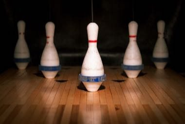

# Five-Pin Bowling

*Quilles a cinq*

**Encyclopedia ID 1410** (permanent) · https://bpupadhyaya.github.io/world-heritage-games-site/games/1410-five-pin-bowling/

*Photo: Benjamin J. DeLong, [CC BY 2.0](https://creativecommons.org/licenses/by/2.0/), [source on Wikimedia Commons](https://commons.wikimedia.org/wiki/File:5-pin_bowling_pins_(4177654894).jpg)*

Small hard rubber balls knock down five numbered pins (value 5-3-2-3-5); players score by pin value across ten frames.

## Heritage note

Part of the living heritage of Canada.

## Origins

Usually placed in the era of Age of Contact and Craft (about 1500 to 1800), although its exact origins are uncertain, within the cultural world of The Americas: North America.

## Facts

- **Where:** Canada
- **Type:** Other traditions
- **Era:** [Age of Contact and Craft](../../eras/contact/index.md) (uncertain)
- **Cradle:** [The Americas: North America](../../cradles/north-america/index.md)
- **Region:** Americas

## Related entries

- [Sled dog race](../../games/62-sled-dog-race/index.md)
- [Horseshoe pitching](../../games/50-horseshoe-pitching/index.md)
- [Barrel racing](../../games/439-barrel-racing/index.md)
- [Tractor pull](../../games/440-tractor-pull/index.md)
- [Maple taffy on snow](../../games/441-maple-taffy-on-snow/index.md)
- [Axe throwing](../../games/442-axe-throwing/index.md)

## Sources

- <https://commons.wikimedia.org/wiki/File:5-pin_bowling_pins_(4177654894).jpg>
