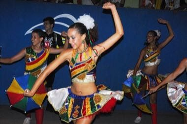

# Frevo Umbrella Dance

*Also known as: Frevo*

**Encyclopedia ID 1411** (permanent) · https://bpupadhyaya.github.io/world-heritage-games-site/games/1411-frevo-umbrella-dance/

*Photo: Prefeitura de Olinda, [CC BY 2.0](https://creativecommons.org/licenses/by/2.0/), [source on Wikimedia Commons](https://commons.wikimedia.org/wiki/File:Frevo_dancers_-_Olinda,_Pernambuco,_Brazil(2).jpg)*

Dancers leap, crouch and kick in fast steps while twirling a small colourful umbrella to brass marching music.

## Heritage note

Part of the living heritage of Brazil.

## Origins

A living tradition passed from person to person; it is not tied to a single dated origin. It belongs to the cultural world of The Americas: Andes and South America.

## Facts

- **Where:** Brazil
- **Type:** Dances
- **Family:** Folk and line dances
- **Era:** [Living Traditions](../../eras/living/index.md)
- **Cradle:** [The Americas: Andes and South America](../../cradles/andes-south-america/index.md)
- **Region:** Americas

## Related entries

- [Cueca](../../games/430-cueca/index.md)
- [Malambo](../../games/1417-malambo/index.md)
- [Bottle Dance](../../games/1424-bottle-dance/index.md)
- [Marinera Norteña](../../games/1472-marinera-nortena/index.md)
- [Dabke line dance](../../games/37-dabke-line-dance/index.md)
- [Gumboot dance rhythm](../../games/123-gumboot-dance-rhythm/index.md)

## Sources

- <https://commons.wikimedia.org/wiki/File:Frevo_dancers_-_Olinda,_Pernambuco,_Brazil(2).jpg>
