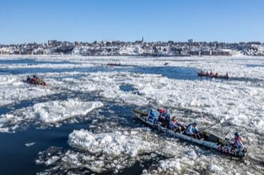

# Ice Canoe Race

*Course en canot a glace*

**Encyclopedia ID 1412** (permanent) · https://bpupadhyaya.github.io/world-heritage-games-site/games/1412-ice-canoe-race/

*Photo: Gabriel Picard, [CC BY-SA 4.0](https://creativecommons.org/licenses/by-sa/4.0/), [source on Wikimedia Commons](https://commons.wikimedia.org/wiki/File:Course_canot_%C3%A0_glace_2024_(7).jpg)*

Teams of five push, drag and paddle a canoe over ice floes of the St Lawrence River, climbing in and out of the boat.

## Heritage note

Part of the living heritage of Canada.

## Origins

A living tradition passed from person to person; it is not tied to a single dated origin. It belongs to the cultural world of The Americas: North America.

## Facts

- **Where:** Canada
- **Type:** Crafts and making
- **Family:** Water sports
- **Era:** [Living Traditions](../../eras/living/index.md)
- **Cradle:** [The Americas: North America](../../cradles/north-america/index.md)
- **Region:** Americas

## Related entries

- [Faustball](../../games/485-faustball/index.md)
- [Fijiri Pearl-Diver Sea Songs](../../games/1280-fijiri-pearl-diver-sea-songs/index.md)
- [Water Polo Sprint](../../games/1398-water-polo-sprint/index.md)
- [Jangada Sailing](../../games/1413-jangada-sailing/index.md)
- [Bequia Boat and Model Builder](../../games/1440-bequia-boat-and-model-builder/index.md)
- [Ecuavoley](../../games/1450-ecuavoley/index.md)

## Sources

- <https://commons.wikimedia.org/wiki/File:Course_canot_%C3%A0_glace_2024_(7).jpg>
