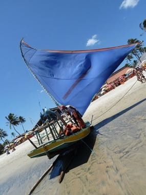

# Jangada Sailing

*Jangada · Ceara fishing raft*

**Encyclopedia ID 1413** (permanent) · https://bpupadhyaya.github.io/world-heritage-games-site/games/1413-jangada-sailing/

*Photo: Boris Karpuk, [CC BY-SA 3.0](https://creativecommons.org/licenses/by-sa/3.0/), [source on Wikimedia Commons](https://commons.wikimedia.org/wiki/File:Jangada,_Cumbuco,_Fortaleza,_Cear%C3%A1,_Brazil_-_panoramio.jpg)*

Fishermen sail a log raft with a triangular sail, steering and balancing against crew weight to reach fishing grounds and return before the wind turns.

## Heritage note

Part of the living heritage of Brazil.

## Origins

A living tradition passed from person to person; it is not tied to a single dated origin. It belongs to the cultural world of The Americas: Andes and South America.

## Facts

- **Where:** Brazil
- **Type:** Crafts and making
- **Family:** Water sports
- **Era:** [Living Traditions](../../eras/living/index.md)
- **Cradle:** [The Americas: Andes and South America](../../cradles/andes-south-america/index.md)
- **Region:** Americas

## Related entries

- [Ecuavoley](../../games/1450-ecuavoley/index.md)
- [Faustball](../../games/485-faustball/index.md)
- [Fijiri Pearl-Diver Sea Songs](../../games/1280-fijiri-pearl-diver-sea-songs/index.md)
- [Water Polo Sprint](../../games/1398-water-polo-sprint/index.md)
- [Ice Canoe Race](../../games/1412-ice-canoe-race/index.md)
- [Bequia Boat and Model Builder](../../games/1440-bequia-boat-and-model-builder/index.md)

## Sources

- <https://commons.wikimedia.org/wiki/File:Jangada,_Cumbuco,_Fortaleza,_Cear%C3%A1,_Brazil_-_panoramio.jpg>
