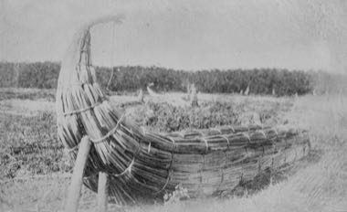

# Lake Chad reed boat builder

*Also known as: Kadei*

**Encyclopedia ID 1416** (permanent) · https://bpupadhyaya.github.io/world-heritage-games-site/games/1416-lake-chad-reed-boat-builder/

*Photo: Steve Bittinger, [CC BY 2.0](https://creativecommons.org/licenses/by/2.0/), [source on Wikimedia Commons](https://commons.wikimedia.org/wiki/File:Reed_boats_at_Lake_Chad.jpg)*

Gather, bundle and lash papyrus reeds into a buoyant boat, balancing the bundles so it sails straight and carries its load.

## Heritage note

Part of the living heritage of Chad.

## Origins

A living tradition passed from person to person; it is not tied to a single dated origin. It belongs to the cultural world of Africa: Sahel, West and Central.

## Facts

- **Where:** Chad
- **Type:** Crafts and making
- **Family:** Wind instruments
- **Era:** [Living Traditions](../../eras/living/index.md)
- **Cradle:** [Africa: Sahel, West and Central](../../cradles/africa-west/index.md)
- **Region:** Sub-Saharan Africa

## Related entries

- [Antelope-horn side-blown trumpet](../../games/17228-antelope-horn-side-blown-trumpet/index.md)
- [Khene](../../games/145-khene/index.md)
- [Mijwiz Double Clarinet](../../games/221-mijwiz-double-clarinet/index.md)
- [Mudhif reed-arch house](../../games/230-mudhif-reed-arch-house/index.md)
- [Lusheng](../../games/337-lusheng/index.md)
- [Launeddas Triple Pipe](../../games/400-launeddas-triple-pipe/index.md)

## Sources

- <https://commons.wikimedia.org/wiki/File:Reed_boats_at_Lake_Chad.jpg>
