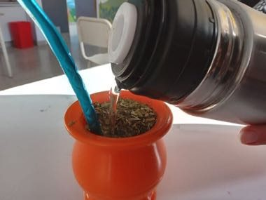

# Mate Pouring

*Also known as: Mate · cebado · Cebar el Mate*

**Encyclopedia ID 1418** (permanent) · https://bpupadhyaya.github.io/world-heritage-games-site/games/1418-mate-pouring/

*Photo: Prácticas Intraescolares, [CC BY-SA 4.0](https://creativecommons.org/licenses/by-sa/4.0/), [source on Wikimedia Commons](https://commons.wikimedia.org/wiki/File:Cebando_mate.jpg)*

Prepare the gourd with yerba, add water at the right temperature and pour into a tilted gourd; keep the pour steady so the foam is perfect.

## Heritage note

Part of the living heritage of Argentina. Some forms of this practice carry deep meaning for the communities who keep it; here we describe the play and the craft only, with respect for its roots.

## Origins

A living tradition passed from person to person; it is not tied to a single dated origin. It belongs to the cultural world of The Americas: Andes and South America.

## Facts

- **Where:** Argentina
- **Type:** Crafts and making
- **Era:** [Living Traditions](../../eras/living/index.md)
- **Cradle:** [The Americas: Andes and South America](../../cradles/andes-south-america/index.md)
- **Region:** Americas

## Related entries

- [Cueca](../../games/430-cueca/index.md)
- [Malambo](../../games/1417-malambo/index.md)
- [Toquilla straw hat weaving](../../games/93-toquilla-straw-hat-weaving/index.md)
- [Nanduti](../../games/428-nanduti/index.md)
- [Vallenato accordion trio](../../games/431-vallenato-accordion-trio/index.md)
- [Frevo Umbrella Dance](../../games/1411-frevo-umbrella-dance/index.md)

## Sources

- <https://commons.wikimedia.org/wiki/File:Cebando_mate.jpg>
