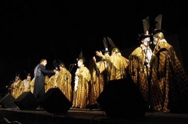

# Murga Uruguaya Carnival Troupe

*Also known as: Murga uruguaya*

**Encyclopedia ID 1419** (permanent) · https://bpupadhyaya.github.io/world-heritage-games-site/games/1419-murga-uruguaya-carnival-troupe/

*Photo: Zeroth, [CC BY-SA 4.0](https://creativecommons.org/licenses/by-sa/4.0/), [source on Wikimedia Commons](https://commons.wikimedia.org/wiki/File:La_Margarita_en_2011.JPG)*

A troupe sings in chorus over three percussion instruments (bombo, platillos, redoblante); the player drives the rhythm sections to match the troupe.

## Heritage note

Part of the living heritage of Uruguay.

## Origins

A living tradition passed from person to person; it is not tied to a single dated origin. It belongs to the cultural world of The Americas: Andes and South America.

## Facts

- **Where:** Uruguay
- **Type:** Crafts and making
- **Family:** Drums and percussion
- **Era:** [Living Traditions](../../eras/living/index.md)
- **Cradle:** [The Americas: Andes and South America](../../cradles/andes-south-america/index.md)
- **Region:** Americas

## Related entries

- [Talking drum](../../games/33-talking-drum/index.md)
- [Tabla Bol Rhythm](../../games/35-tabla-bol-rhythm/index.md)
- [Marimba](../../games/52-marimba/index.md)
- [Calabash Water Drum](../../games/180-calabash-water-drum/index.md)
- [Amadinda and embaire](../../games/185-amadinda-and-embaire/index.md)
- [Isukuti drum dance](../../games/191-isukuti-drum-dance/index.md)

## Sources

- <https://commons.wikimedia.org/wiki/File:La_Margarita_en_2011.JPG>
