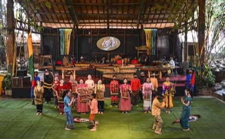

# Angklung bamboo chime ensemble

*Also known as: Angklung*

**Encyclopedia ID 142** (permanent) · https://bpupadhyaya.github.io/world-heritage-games-site/games/142-angklung-bamboo-chime-ensemble/

*Photo: Irhanz, [CC BY-SA 4.0](https://creativecommons.org/licenses/by-sa/4.0/), [source on Wikimedia Commons](https://commons.wikimedia.org/wiki/File:Pertunjukan_Angklung_di_Saung_Angklung_Udjo.jpg)*

Each shaken bamboo frame plays one note; you hold a few notes and shake them exactly when the falling cue reaches the line so that together they form a melody.

## Heritage note

Part of the living heritage of Indonesia. Some forms of this practice carry deep meaning for the communities who keep it; here we describe the play and the craft only, with respect for its roots.

## Origins

A living tradition passed from person to person; it is not tied to a single dated origin. It belongs to the cultural world of Southeast Asia and the Islands.

## Facts

- **Where:** Indonesia
- **Type:** Musical instruments
- **Era:** [Living Traditions](../../eras/living/index.md)
- **Cradle:** [Southeast Asia and the Islands](../../cradles/southeast-asia/index.md)
- **Region:** East and Southeast Asia

## Related entries

- [Greasy pole climb](../../games/77-greasy-pole-climb/index.md)
- [Batik wax-resist pattern studio](../../games/105-batik-wax-resist-pattern-studio/index.md)
- [Songket](../../games/320-songket/index.md)
- [Ketupat](../../games/322-ketupat/index.md)
- [Kendang](../../games/10163-kendang/index.md)
- [Prasi](../../games/15096-prasi/index.md)

## Sources

- <https://commons.wikimedia.org/wiki/File:Pertunjukan_Angklung_di_Saung_Angklung_Udjo.jpg>
