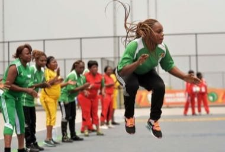

# Nzango

*Nzango · clap-and-foot court game*

**Encyclopedia ID 1422** (permanent) · https://equalinformation.com/world-heritage-games-site/games/1422-nzango/

*Photo: Hermas kadianga ONGA, [CC BY-SA 4.0](https://creativecommons.org/licenses/by-sa/4.0/), [source on Wikimedia Commons](https://commons.wikimedia.org/wiki/File:Femmes_jouant_au_Nzango_en_2018.jpg)*

Two teams chant and clap while each player in turn tries to outmanoeuvre an opponent's foot position to win a point.

## Heritage note

Part of the living heritage of Congo.

## Origins

Usually placed in the era of Crossroads and Golden Ages (about 500 to 1500), although its exact origins are uncertain, within the cultural world of Africa: Sahel, West and Central.

## Facts

- **Where:** Congo
- **Type:** Board and table games
- **Era:** [Crossroads and Golden Ages](../../eras/crossroads/index.md) (uncertain)
- **Cradle:** [Africa: Sahel, West and Central](../../cradles/africa-west/index.md)
- **Region:** Sub-Saharan Africa

## Related entries

- [Yote Capture Grid](../../games/167-yote-capture-grid/index.md)
- [Sahel Salt Caravan](../../games/172-sahel-salt-caravan/index.md)
- [Queah](../../games/885-queah/index.md)
- [Acadja Fish Park](../../games/1223-acadja-fish-park/index.md)
- [Balanta Mangrove Rice Polder](../../games/1235-balanta-mangrove-rice-polder/index.md)
- [Vai Syllabary Decoder](../../games/1394-vai-syllabary-decoder/index.md)

## Sources

- <https://commons.wikimedia.org/wiki/File:Femmes_jouant_au_Nzango_en_2018.jpg>
