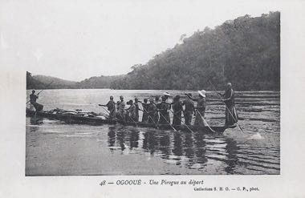

# Ogooué river pirogue journey

**Encyclopedia ID 1423** (permanent) · https://bpupadhyaya.github.io/world-heritage-games-site/games/1423-ogooue-river-pirogue-journey/

*Photo: Unknown authorUnknown author, [Public domain](https://creativecommons.org/publicdomain/mark/1.0/), [source on Wikimedia Commons](https://commons.wikimedia.org/wiki/File:Ogooué-Une_pirogue_au_départ.jpg)*

Paddle and pole a dugout pirogue upstream, reading rapids and currents and loading cargo at river landings.

## Heritage note

Part of the living heritage of Gabon.

## Origins

Usually placed in the era of Crossroads and Golden Ages (about 500 to 1500), although its exact origins are uncertain, within the cultural world of Africa: Sahel, West and Central.

## Facts

- **Where:** Gabon
- **Type:** Racing
- **Family:** Water sports
- **Era:** [Crossroads and Golden Ages](../../eras/crossroads/index.md) (uncertain)
- **Cradle:** [Africa: Sahel, West and Central](../../cradles/africa-west/index.md)
- **Region:** Sub-Saharan Africa

## Related entries

- [Nouka Baich](../../games/42-nouka-baich/index.md)
- [Pirogue coastal canoe race](../../games/56-pirogue-coastal-canoe-race/index.md)
- [Yote Capture Grid](../../games/167-yote-capture-grid/index.md)
- [Sahel Salt Caravan](../../games/172-sahel-salt-caravan/index.md)
- [Nile Felucca Sailing](../../games/216-nile-felucca-sailing/index.md)
- [Shikara paddle race](../../games/265-shikara-paddle-race/index.md)

## Sources

- <https://commons.wikimedia.org/wiki/File:Ogooué-Une_pirogue_au_départ.jpg>
