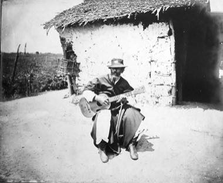

# Payada

*Payada · rhyming verse duel*

**Encyclopedia ID 1426** (permanent) · https://bpupadhyaya.github.io/world-heritage-games-site/games/1426-payada/

*Photo: Unknown authorUnknown author, [Public domain](https://creativecommons.org/publicdomain/mark/1.0/), [source on Wikimedia Commons](https://commons.wikimedia.org/wiki/File:Payador_rancho.jpg)*

Two payadores sing improvised rhyming verses to guitar, each answering the other's subject.

## Heritage note

Part of the living heritage of Argentina, Uruguay.

## Origins

Usually placed in the era of Classical Worlds (about 1000 BCE to 500 CE), although its exact origins are uncertain, within the cultural world of The Americas: Andes and South America.

## Facts

- **Where:** Argentina, Uruguay
- **Type:** Wrestling and martial sports
- **Era:** [Classical Worlds](../../eras/classical/index.md) (uncertain)
- **Cradle:** [The Americas: Andes and South America](../../cradles/andes-south-america/index.md)
- **Region:** Americas

## Related entries

- [Joropo llanero band](../../games/130-joropo-llanero-band/index.md)
- [Circle Dodgeball](../../games/470-circle-dodgeball/index.md)
- [Paraguayan Harp](../../games/1425-paraguayan-harp/index.md)
- [Generala](../../games/422-generala/index.md)
- [Bandoneon and tango rhythm](../../games/426-bandoneon-and-tango-rhythm/index.md)
- [Cueca](../../games/430-cueca/index.md)

## Sources

- <https://commons.wikimedia.org/wiki/File:Payador_rancho.jpg>
