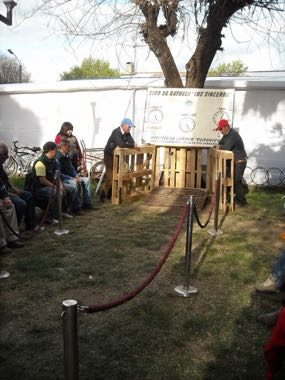

# Chilean Rayuela

*Also known as: Rayuela chilena · disc pitching*

**Encyclopedia ID 1427** (permanent) · https://bpupadhyaya.github.io/world-heritage-games-site/games/1427-chilean-rayuela/

*Photo: 3BRBS, [CC BY 3.0](https://creativecommons.org/licenses/by/3.0/), [source on Wikimedia Commons](https://commons.wikimedia.org/wiki/File:Rayuela_-_San_Fernando_-_Chile_01.JPG)*

Two sides pitch heavy metal discs (tejos) onto a clay-filled box with a taut chalk line; the closest to the line scores and a disc touching the line scores more.

## Heritage note

Part of the living heritage of Chile.

## Origins

Usually placed in the era of Modern Heritage (1800 to today), although its exact origins are uncertain, within the cultural world of The Americas: Andes and South America.

## Facts

- **Where:** Chile
- **Type:** Archery, throwing and target games
- **Family:** Archery and target games
- **Era:** [Modern Heritage](../../eras/modern/index.md) (uncertain)
- **Cradle:** [The Americas: Andes and South America](../../cradles/andes-south-america/index.md)
- **Region:** Americas

## Related entries

- [Tejo](../../games/57-tejo/index.md)
- [Pitch-pot](../../games/2-pitch-pot/index.md)
- [Jukskei](../../games/11-jukskei/index.md)
- [Lagori](../../games/14-lagori/index.md)
- [Bocce](../../games/830-bocce/index.md)
- [Kubb](../../games/1120-kubb/index.md)

## Sources

- <https://commons.wikimedia.org/wiki/File:Rayuela_-_San_Fernando_-_Chile_01.JPG>
