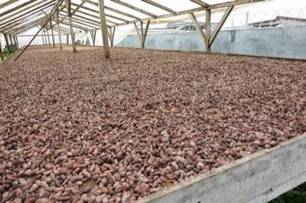

# São Tomé cocoa and chocolate maker

**Encyclopedia ID 1428** (permanent) · https://bpupadhyaya.github.io/world-heritage-games-site/games/1428-sao-tome-cocoa-and-chocolate-maker/

*Photo: Ji-Elle, [CC BY-SA 4.0](https://creativecommons.org/licenses/by-sa/4.0/), [source on Wikimedia Commons](https://commons.wikimedia.org/wiki/File:Séchage_du_cacao_à_Generosa_(São_Tomé)_(1).jpg)*

Ferment, dry, sort, roast and grind cocoa beans in the right order and timing, then mould and wrap bars.

## Heritage note

Part of the living heritage of Sao Tome and Principe.

## Origins

A living tradition passed from person to person; it is not tied to a single dated origin. It belongs to the cultural world of Africa: Sahel, West and Central.

## Facts

- **Where:** Sao Tome and Principe
- **Type:** Crafts and making
- **Era:** [Living Traditions](../../eras/living/index.md)
- **Cradle:** [Africa: Sahel, West and Central](../../cradles/africa-west/index.md)
- **Region:** Sub-Saharan Africa

## Related entries

- [Tchiloli masked play](../../games/1430-tchiloli-masked-play/index.md)
- [Kente strip weaving](../../games/22-kente-strip-weaving/index.md)
- [Talking drum](../../games/33-talking-drum/index.md)
- [Bogolan mud cloth](../../games/86-bogolan-mud-cloth/index.md)
- [Adire indigo resist dyeing](../../games/87-adire-indigo-resist-dyeing/index.md)
- [Kuba cloth pattern puzzle](../../games/91-kuba-cloth-pattern-puzzle/index.md)

## Sources

- <https://commons.wikimedia.org/wiki/File:Séchage_du_cacao_à_Generosa_(São_Tomé)_(1).jpg>
