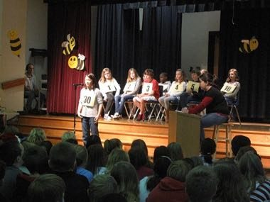

# Spelling Bee

**Encyclopedia ID 1429** (permanent) · https://bpupadhyaya.github.io/world-heritage-games-site/games/1429-spelling-bee/

*Photo: Heather Temske, [CC BY 2.0](https://creativecommons.org/licenses/by/2.0/), [source on Wikimedia Commons](https://commons.wikimedia.org/wiki/File:Elementary_school_spelling_bee,_December_2011.jpg)*

Contestants spell given words aloud letter by letter in knockout rounds, with word, definition and origin asked beforehand.

## Heritage note

Part of the living heritage of United States.

## Origins

Usually placed in the era of Crossroads and Golden Ages (about 500 to 1500), although its exact origins are uncertain, within the cultural world of The Americas: North America.

## Facts

- **Where:** United States
- **Type:** Other traditions
- **Era:** [Crossroads and Golden Ages](../../eras/crossroads/index.md) (uncertain)
- **Cradle:** [The Americas: North America](../../cradles/north-america/index.md)
- **Region:** Americas

## Related entries

- [Chickenfoot](../../games/1193-chickenfoot/index.md)
- [Texas 42](../../games/1195-texas-42/index.md)
- [Bingo](../../games/622-bingo/index.md)
- [Horseshoe pitching](../../games/50-horseshoe-pitching/index.md)
- [Double Dutch](../../games/53-double-dutch/index.md)
- [Sled dog race](../../games/62-sled-dog-race/index.md)

## Sources

- <https://commons.wikimedia.org/wiki/File:Elementary_school_spelling_bee,_December_2011.jpg>
