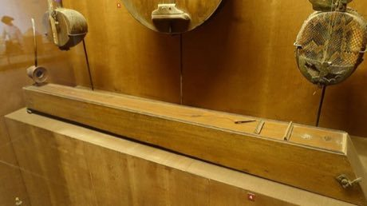

# Dan bau

*Also known as: Đàn bầu · Vietnamese monochord*

**Encyclopedia ID 143** (permanent) · https://bpupadhyaya.github.io/world-heritage-games-site/games/143-dan-bau/

*Photo: Daderot, [CC0](https://creativecommons.org/publicdomain/zero/1.0/), [source on Wikimedia Commons](https://commons.wikimedia.org/wiki/File:Dan_bau_(monochord)_-_Vietnam_Museum_of_Ethnology_-_Hanoi,_Vietnam_-_DSC02538.JPG)*

Pluck the single string and bend the pitch by moving a flexible rod with a finger; slide along the guide line to match the sung melody notes.

## Heritage note

Part of the living heritage of Vietnam.

## Origins

A living tradition passed from person to person; it is not tied to a single dated origin. It belongs to the cultural world of Southeast Asia and the Islands.

## Facts

- **Where:** Vietnam
- **Type:** Musical instruments
- **Family:** String instruments
- **Era:** [Living Traditions](../../eras/living/index.md)
- **Cradle:** [Southeast Asia and the Islands](../../cradles/southeast-asia/index.md)
- **Region:** East and Southeast Asia

## Related entries

- [Phuang malai flower garland threading](../../games/309-phuang-malai-flower-garland-threading/index.md)
- [Santur Hammer Strings](../../games/138-santur-hammer-strings/index.md)
- [Santoor](../../games/151-santoor/index.md)
- [Goje One-String Fiddle](../../games/176-goje-one-string-fiddle/index.md)
- [Masenqo and the azmari](../../games/187-masenqo-and-the-azmari/index.md)
- [Hira gasy village troupe contest](../../games/205-hira-gasy-village-troupe-contest/index.md)

## Sources

- <https://commons.wikimedia.org/wiki/File:Dan_bau_(monochord)_-_Vietnam_Museum_of_Ethnology_-_Hanoi,_Vietnam_-_DSC02538.JPG>
- <https://en.wikipedia.org/wiki/%C4%90%C3%A0n_b%E1%BA%A7u>
