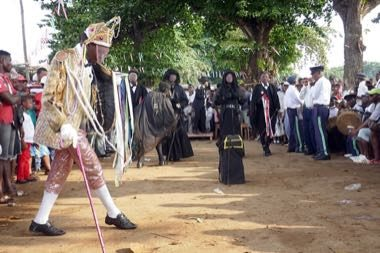

# Tchiloli masked play

*Also known as: Tchiloli*

**Encyclopedia ID 1430** (permanent) · https://bpupadhyaya.github.io/world-heritage-games-site/games/1430-tchiloli-masked-play/

*Photo: Ji-Elle, [CC BY-SA 4.0](https://creativecommons.org/licenses/by-sa/4.0/), [source on Wikimedia Commons](https://commons.wikimedia.org/wiki/File:Tchiloli_à_São_Tomé_(56).jpg)*

Stage a procession and courtroom drama by choosing characters, costumes, masks and cues, then conducting the verse rounds.

## Heritage note

Part of the living heritage of Sao Tome and Principe. Some forms of this practice carry deep meaning for the communities who keep it; here we describe the play and the craft only, with respect for its roots.

## Origins

A living tradition passed from person to person; it is not tied to a single dated origin. It belongs to the cultural world of Africa: Sahel, West and Central.

## Facts

- **Where:** Sao Tome and Principe
- **Type:** Performance and storytelling
- **Era:** [Living Traditions](../../eras/living/index.md)
- **Cradle:** [Africa: Sahel, West and Central](../../cradles/africa-west/index.md)
- **Region:** Sub-Saharan Africa

## Related entries

- [São Tomé cocoa and chocolate maker](../../games/1428-sao-tome-cocoa-and-chocolate-maker/index.md)
- [Kente strip weaving](../../games/22-kente-strip-weaving/index.md)
- [Talking drum](../../games/33-talking-drum/index.md)
- [Bogolan mud cloth](../../games/86-bogolan-mud-cloth/index.md)
- [Adire indigo resist dyeing](../../games/87-adire-indigo-resist-dyeing/index.md)
- [Kuba cloth pattern puzzle](../../games/91-kuba-cloth-pattern-puzzle/index.md)

## Sources

- <https://commons.wikimedia.org/wiki/File:Tchiloli_à_São_Tomé_(56).jpg>
