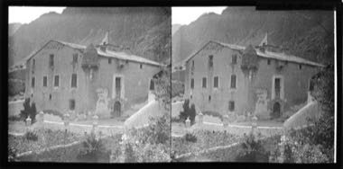

# Seven-Key Cabinet Puzzle

*Armari de les Set Claus*

**Encyclopedia ID 1432** (permanent) · https://equalinformation.com/world-heritage-games-site/games/1432-seven-key-cabinet-puzzle/

*Photo: Frederic Bordas Altarriba, [Public domain](https://creativecommons.org/publicdomain/mark/1.0/), [source on Wikimedia Commons](https://commons.wikimedia.org/wiki/File:Casa_de_la_Vall_d%27Andorra_la_vella_(AFCEC_BORDAS_X_595).jpeg)*

Control seven key-holders around a historic council house; collect each key from its parish tower and bring all seven to the cabinet in the right order, with doors that need two keys at once.

## Heritage note

Part of the living heritage of Andorra.

## Origins

A living tradition passed from person to person; it is not tied to a single dated origin. It belongs to the cultural world of Mediterranean.

## Facts

- **Where:** Andorra
- **Type:** Performance and storytelling
- **Era:** [Living Traditions](../../eras/living/index.md)
- **Cradle:** [Mediterranean](../../cradles/mediterranean/index.md)
- **Region:** Europe

## Related entries

- [Zellij tile mosaic](../../games/21-zellij-tile-mosaic/index.md)
- [Glassblowing](../../games/121-glassblowing/index.md)
- [Azulejo tile painting](../../games/122-azulejo-tile-painting/index.md)
- [Lefkara Lace](../../games/220-lefkara-lace/index.md)
- [Amazigh Rug Weaving](../../games/224-amazigh-rug-weaving/index.md)
- [Txalaparta Duet](../../games/390-txalaparta-duet/index.md)

## Sources

- <https://commons.wikimedia.org/wiki/File:Casa_de_la_Vall_d%27Andorra_la_vella_(AFCEC_BORDAS_X_595).jpeg>
