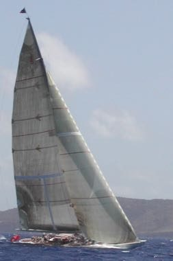

# Antigua Classic Yacht Race

*Also known as: Classic yacht racing*

**Encyclopedia ID 1433** (permanent) · https://bpupadhyaya.github.io/world-heritage-games-site/games/1433-antigua-classic-yacht-race/

*Photo: Trappist the monk, [CC BY 3.0](https://creativecommons.org/licenses/by/3.0/), [source on Wikimedia Commons](https://commons.wikimedia.org/wiki/File:Ranger_at_Antigua_Classic_Yacht_Regatta_2005.jpg)*

Trim sails, read the wind and round the buoys in a race of large wooden classic yachts.

## Heritage note

Part of the living heritage of Antigua and Barbuda, United Kingdom.

## Origins

Usually placed in the era of Age of Contact and Craft (about 1500 to 1800), although its exact origins are uncertain, within the cultural world of The Americas: Caribbean.

## Facts

- **Where:** Antigua and Barbuda, United Kingdom
- **Type:** Racing
- **Family:** Water sports
- **Era:** [Age of Contact and Craft](../../eras/contact/index.md) (uncertain)
- **Cradle:** [The Americas: Caribbean](../../cradles/caribbean/index.md)
- **Region:** Americas

## Related entries

- [Nouka Baich](../../games/42-nouka-baich/index.md)
- [Pirogue coastal canoe race](../../games/56-pirogue-coastal-canoe-race/index.md)
- [Nile Felucca Sailing](../../games/216-nile-felucca-sailing/index.md)
- [Shikara paddle race](../../games/265-shikara-paddle-race/index.md)
- [Hanetsuki](../../games/347-hanetsuki/index.md)
- [Venetian lagoon regatta](../../games/486-venetian-lagoon-regatta/index.md)

## Sources

- <https://commons.wikimedia.org/wiki/File:Ranger_at_Antigua_Classic_Yacht_Regatta_2005.jpg>
