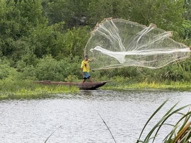

# Atarraya

*Also known as: cast-net throwing*

**Encyclopedia ID 1434** (permanent) · https://bpupadhyaya.github.io/world-heritage-games-site/games/1434-atarraya/

*Photo: Gccortesb, [CC BY-SA 4.0](https://creativecommons.org/licenses/by-sa/4.0/), [source on Wikimedia Commons](https://commons.wikimedia.org/wiki/File:El_pescador_y_su_atarraya.jpg)*

Hold the weighted net in coiled loops, spin and throw it so it opens into a perfect circle over a shoal, then haul it in.

## Heritage note

Part of the living heritage of Colombia.

## Origins

Usually placed in the era of Modern Heritage (1800 to today), although its exact origins are uncertain, within the cultural world of The Americas: Andes and South America.

## Facts

- **Where:** Colombia
- **Type:** Dexterity and skill games
- **Family:** Puzzle and dexterity toys
- **Era:** [Modern Heritage](../../eras/modern/index.md) (uncertain)
- **Cradle:** [The Americas: Andes and South America](../../cradles/andes-south-america/index.md)
- **Region:** Americas

## Related entries

- [Rana](../../games/645-rana/index.md)
- [Emboque](../../games/629-emboque/index.md)
- [Frog toss](../../games/688-frog-toss/index.md)
- [Uyuni Salt Harvest](../../games/1491-uyuni-salt-harvest/index.md)
- [Sapo](../../games/1019-sapo/index.md)
- [Perinola](../../games/1212-perinola/index.md)

## Sources

- <https://commons.wikimedia.org/wiki/File:El_pescador_y_su_atarraya.jpg>
