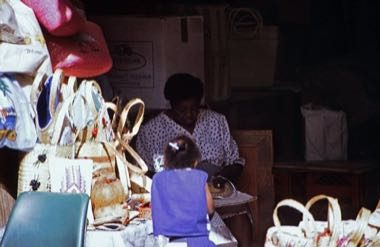

# Bahamian Straw Plaiting

*Straw work*

**Encyclopedia ID 1435** (permanent) · https://bpupadhyaya.github.io/world-heritage-games-site/games/1435-bahamian-straw-plaiting/

*Photo: Rüdiger Stehn, [CC BY-SA 2.0](https://creativecommons.org/licenses/by-sa/2.0/), [source on Wikimedia Commons](https://commons.wikimedia.org/wiki/File:Bahamas_1988_(174)_New_Providence_Straw_Market,_Nassau_(23841199426).jpg)*

Plait strips of palm straw into braids, then coil and sew them into hats, baskets and bags following traditional patterns.

## Heritage note

Part of the living heritage of Bahamas.

## Origins

A living tradition passed from person to person; it is not tied to a single dated origin. It belongs to the cultural world of The Americas: Caribbean.

## Facts

- **Where:** Bahamas
- **Type:** Crafts and making
- **Family:** Paper, ink and painting crafts
- **Era:** [Living Traditions](../../eras/living/index.md)
- **Cradle:** [The Americas: Caribbean](../../cradles/caribbean/index.md)
- **Region:** Americas

## Related entries

- [Tap-Tap Bus Painting](../../games/1461-tap-tap-bus-painting/index.md)
- [Ebru paper marbling](../../games/20-ebru-paper-marbling/index.md)
- [Ndebele geometric wall painting](../../games/23-ndebele-geometric-wall-painting/index.md)
- [Chinese knotting](../../games/26-chinese-knotting/index.md)
- [Matryoshka](../../games/28-matryoshka/index.md)
- [Bogolan mud cloth](../../games/86-bogolan-mud-cloth/index.md)

## Sources

- <https://commons.wikimedia.org/wiki/File:Bahamas_1988_(174)_New_Providence_Straw_Market,_Nassau_(23841199426).jpg>
