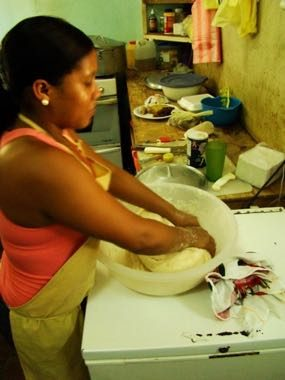

# Baleada Stand

*Baleada · street tortilla cook*

**Encyclopedia ID 1436** (permanent) · https://bpupadhyaya.github.io/world-heritage-games-site/games/1436-baleada-stand/

*Photo: Inti Martínez Alemán, [CC BY 2.0](https://creativecommons.org/licenses/by/2.0/), [source on Wikimedia Commons](https://commons.wikimedia.org/wiki/File:Baleada_making_in_Roatan.jpg)*

Press and stretch flour-tortilla dough on a hot comal, fold it over beans, cheese and cream, and serve the queue before orders time out.

## Heritage note

Part of the living heritage of Honduras.

## Origins

A living tradition passed from person to person; it is not tied to a single dated origin. It belongs to the cultural world of The Americas: Mesoamerica.

## Facts

- **Where:** Honduras
- **Type:** Crafts and making
- **Era:** [Living Traditions](../../eras/living/index.md)
- **Cradle:** [The Americas: Mesoamerica](../../cradles/meso-america/index.md)
- **Region:** Americas

## Related entries

- [Alebrije painting](../../games/92-alebrije-painting/index.md)
- [Costa Rican painted oxcart](../../games/427-costa-rican-painted-oxcart/index.md)
- [Talavera tile painting](../../games/429-talavera-tile-painting/index.md)
- [Chinampa Gardens](../../games/1444-chinampa-gardens/index.md)
- [Chorreador](../../games/1446-chorreador/index.md)
- [Masaya Hammock Weaving](../../games/1473-masaya-hammock-weaving/index.md)

## Sources

- <https://commons.wikimedia.org/wiki/File:Baleada_making_in_Roatan.jpg>
