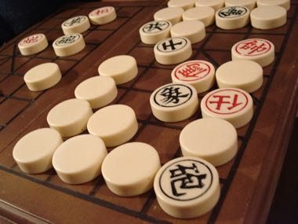

# Banqi

*Also known as: 暗棋 · Dark Chess*

**Encyclopedia ID 1437** (permanent) · https://bpupadhyaya.github.io/world-heritage-games-site/games/1437-banqi/

*Photo: w:Zen., wc:User:Alton, [CC BY-SA 3.0](https://creativecommons.org/licenses/by-sa/3.0/), [source on Wikimedia Commons](https://commons.wikimedia.org/wiki/File:BanQi.jpg)*

All 32 xiangqi pieces lie face-down on a 4x8 grid; on your turn flip one or move/capture with a revealed piece of your colour, using the rank chain (general beats all but soldier; soldier beats general).

## Heritage note

Part of the living heritage of China, Taiwan.

## Origins

Usually placed in the era of Crossroads and Golden Ages (about 500 to 1500), although its exact origins are uncertain, within the cultural world of China.

## Facts

- **Where:** China, Taiwan
- **Type:** Board and table games
- **Family:** Chess family
- **Era:** [Crossroads and Golden Ages](../../eras/crossroads/index.md) (uncertain)
- **Cradle:** [China](../../cradles/china/index.md)
- **Region:** East and Southeast Asia

## Related entries

- [Xiangqi](../../games/636-xiangqi/index.md)
- [Luzhanqi](../../games/640-luzhanqi/index.md)
- [Chaturanga](../../games/45-chaturanga/index.md)
- [Sittuyin](../../games/302-sittuyin/index.md)
- [Mongolian chess](../../games/943-mongolian-chess/index.md)
- [Chess](../../games/552-chess/index.md)

## Sources

- <https://commons.wikimedia.org/wiki/File:BanQi.jpg>
