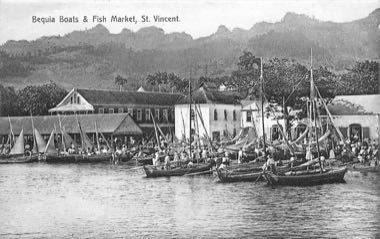

# Bequia Boat and Model Builder

*Bequia boatbuilding*

**Encyclopedia ID 1440** (permanent) · https://bpupadhyaya.github.io/world-heritage-games-site/games/1440-bequia-boat-and-model-builder/

*Photo: Unknown author (historic postcard), [Public domain](https://creativecommons.org/publicdomain/mark/1.0/), [source on Wikimedia Commons](https://commons.wikimedia.org/wiki/File:Saint_Vincent_-_Bequia_boats_&_fish_market.jpg)*

Shape a hull from planks, then add ribs, mast and sails to build a boat or a handsome scale model.

## Heritage note

Part of the living heritage of Saint Vincent and the Grenadines.

## Origins

A living tradition passed from person to person; it is not tied to a single dated origin. It belongs to the cultural world of The Americas: Caribbean.

## Facts

- **Where:** Saint Vincent and the Grenadines
- **Type:** Crafts and making
- **Family:** Water sports
- **Era:** [Living Traditions](../../eras/living/index.md)
- **Cradle:** [The Americas: Caribbean](../../cradles/caribbean/index.md)
- **Region:** Americas

## Related entries

- [Faustball](../../games/485-faustball/index.md)
- [Fijiri Pearl-Diver Sea Songs](../../games/1280-fijiri-pearl-diver-sea-songs/index.md)
- [Water Polo Sprint](../../games/1398-water-polo-sprint/index.md)
- [Ice Canoe Race](../../games/1412-ice-canoe-race/index.md)
- [Jangada Sailing](../../games/1413-jangada-sailing/index.md)
- [Ecuavoley](../../games/1450-ecuavoley/index.md)

## Sources

- <https://commons.wikimedia.org/wiki/File:Saint_Vincent_-_Bequia_boats_&_fish_market.jpg>
