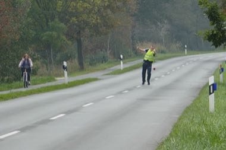

# Frisian Road Bowling

*Boßeln / Klootschießen · Boßeln*

**Encyclopedia ID 1441** (permanent) · https://bpupadhyaya.github.io/world-heritage-games-site/games/1441-frisian-road-bowling/

*Photo: Hartmut Schmidt Heidelberg, [CC BY-SA 4.0](https://creativecommons.org/licenses/by-sa/4.0/), [source on Wikimedia Commons](https://commons.wikimedia.org/wiki/File:Bo%C3%9Feln_(road_bowling)_at_country_road_near_Leezdorf,_East_Frisia,_Germany.jpg)*

Teams throw a small rubber-and-steel ball along a country road; the team that gets farthest in the fewest throws wins; use of curves and gutters decides.

## Heritage note

Part of the living heritage of Ireland, Netherlands, Germany.

## Origins

Usually placed in the era of Age of Contact and Craft (about 1500 to 1800), although its exact origins are uncertain, within the cultural world of Celtic and Atlantic Europe.

## Facts

- **Where:** Ireland, Netherlands, Germany
- **Type:** Dexterity and skill games
- **Family:** Winter sports
- **Era:** [Age of Contact and Craft](../../eras/contact/index.md) (uncertain)
- **Cradle:** [Celtic and Atlantic Europe](../../cradles/celtic-atlantic/index.md)
- **Region:** Europe

## Related entries

- [Candlepin bowling](../../games/444-candlepin-bowling/index.md)
- [Finnish pin toss](../../games/49-finnish-pin-toss/index.md)
- [Sled dog race](../../games/62-sled-dog-race/index.md)
- [Kicksled Race](../../games/407-kicksled-race/index.md)
- [Luge and toboggan run](../../games/482-luge-and-toboggan-run/index.md)
- [Bagatelle](../../games/72-bagatelle/index.md)

## Sources

- <https://commons.wikimedia.org/wiki/File:Bo%C3%9Feln_(road_bowling)_at_country_road_near_Leezdorf,_East_Frisia,_Germany.jpg>
