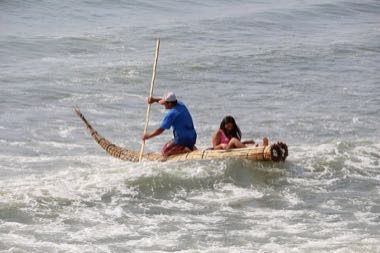

# Caballito de totora

*Caballito de totora · reed riding-boat*

**Encyclopedia ID 1442** (permanent) · https://equalinformation.com/world-heritage-games-site/games/1442-caballito-de-totora/

*Photo: Bernard Gagnon, [CC BY-SA 3.0](https://creativecommons.org/licenses/by-sa/3.0/), [source on Wikimedia Commons](https://commons.wikimedia.org/wiki/File:Reed_boat_in_Huanchaco.jpg)*

Bind totora reeds into the pointed boat, then paddle out kneeling and balance over swells to cast and haul the fishing line, riding waves back to shore.

## Heritage note

Part of the living heritage of Peru.

## Origins

A living tradition passed from person to person; it is not tied to a single dated origin. It belongs to the cultural world of The Americas: Andes and South America.

## Facts

- **Where:** Peru
- **Type:** Crafts and making
- **Family:** Wind instruments
- **Era:** [Living Traditions](../../eras/living/index.md)
- **Cradle:** [The Americas: Andes and South America](../../cradles/andes-south-america/index.md)
- **Region:** Americas

## Related entries

- [Khene](../../games/145-khene/index.md)
- [Mijwiz Double Clarinet](../../games/221-mijwiz-double-clarinet/index.md)
- [Mudhif reed-arch house](../../games/230-mudhif-reed-arch-house/index.md)
- [Lusheng](../../games/337-lusheng/index.md)
- [Launeddas Triple Pipe](../../games/400-launeddas-triple-pipe/index.md)
- [Rubboard zydeco rhythm](../../games/437-rubboard-zydeco-rhythm/index.md)

## Sources

- <https://commons.wikimedia.org/wiki/File:Reed_boat_in_Huanchaco.jpg>
