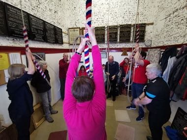

# Change Ringing

*Also known as: Bell Method Puzzle*

**Encyclopedia ID 1443** (permanent) · https://bpupadhyaya.github.io/world-heritage-games-site/games/1443-change-ringing/

*Photo: Qazwsx777, [CC BY-SA 4.0](https://creativecommons.org/licenses/by-sa/4.0/), [source on Wikimedia Commons](https://commons.wikimedia.org/wiki/File:Bell_ringing_at_Great_Barton,_Suffolk.jpg)*

Pull the ropes in the correct order so the bells sound in changing sequences (Plain Hunt, Grandsire style), learning each place in the pattern without clashing.

## Heritage note

Part of the living heritage of United Kingdom. Some forms of this practice carry deep meaning for the communities who keep it; here we describe the play and the craft only, with respect for its roots.

## Origins

Usually placed in the era of Age of Contact and Craft (about 1500 to 1800), although its exact origins are uncertain, within the cultural world of Celtic and Atlantic Europe.

## Facts

- **Where:** United Kingdom
- **Type:** Puzzles and mind games
- **Family:** Puzzle and dexterity toys
- **Era:** [Age of Contact and Craft](../../eras/contact/index.md) (uncertain)
- **Cradle:** [Celtic and Atlantic Europe](../../cradles/celtic-atlantic/index.md)
- **Region:** Europe

## Related entries

- [Disc-flip](../../games/8-disc-flip/index.md)
- [Shove ha'penny](../../games/54-shove-hapenny/index.md)
- [Charro lasso roping](../../games/60-charro-lasso-roping/index.md)
- [Fukuwarai](../../games/94-fukuwarai/index.md)
- [Sangaku Geometry Puzzles](../../games/109-sangaku-geometry-puzzles/index.md)
- [Lo Shu Magic Square](../../games/111-lo-shu-magic-square/index.md)

## Sources

- <https://commons.wikimedia.org/wiki/File:Bell_ringing_at_Great_Barton,_Suffolk.jpg>
