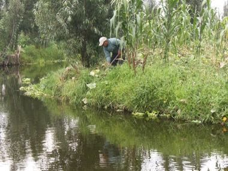

# Chinampa Gardens

*Also known as: Chinampas de Xochimilco · floating-garden farming*

**Encyclopedia ID 1444** (permanent) · https://bpupadhyaya.github.io/world-heritage-games-site/games/1444-chinampa-gardens/

*Photo: Jflo23, [CC BY-SA 3.0](https://creativecommons.org/licenses/by-sa/3.0/), [source on Wikimedia Commons](https://commons.wikimedia.org/wiki/File:Chinampa.JPG)*

Build rafts of reed and mud on the lake, plant strips of vegetables and flowers and rotate crops while canoes carry the harvest.

## Heritage note

Part of the living heritage of Mexico. Some forms of this practice carry deep meaning for the communities who keep it; here we describe the play and the craft only, with respect for its roots.

## Origins

A living tradition passed from person to person; it is not tied to a single dated origin. It belongs to the cultural world of The Americas: Mesoamerica.

## Facts

- **Where:** Mexico
- **Type:** Crafts and making
- **Family:** Wind instruments
- **Era:** [Living Traditions](../../eras/living/index.md)
- **Cradle:** [The Americas: Mesoamerica](../../cradles/meso-america/index.md)
- **Region:** Americas

## Related entries

- [Khene](../../games/145-khene/index.md)
- [Mijwiz Double Clarinet](../../games/221-mijwiz-double-clarinet/index.md)
- [Mudhif reed-arch house](../../games/230-mudhif-reed-arch-house/index.md)
- [Lusheng](../../games/337-lusheng/index.md)
- [Launeddas Triple Pipe](../../games/400-launeddas-triple-pipe/index.md)
- [Vallenato accordion trio](../../games/431-vallenato-accordion-trio/index.md)

## Sources

- <https://commons.wikimedia.org/wiki/File:Chinampa.JPG>
