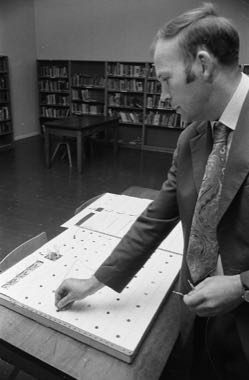

# Cynghanedd Poetry Puzzle

*Cynghanedd*

**Encyclopedia ID 1448** (permanent) · https://equalinformation.com/world-heritage-games-site/games/1448-cynghanedd-poetry-puzzle/

*Photo: Geoff Charles, [CC BY-SA 4.0](https://creativecommons.org/licenses/by-sa/4.0/), [source on Wikimedia Commons](https://commons.wikimedia.org/wiki/File:Dr_Iwan_Bryn_Williams_has_invented_an_electrical_%27cynghanedd%27_game_(1586009).jpg)*

Fill a line so its consonants repeat in a fixed pattern (cross-rhyme, sain, llusg), solving a clue like a crossword for sound.

## Heritage note

Part of the living heritage of United Kingdom.

## Origins

Usually placed in the era of Modern Heritage (1800 to today), although its exact origins are uncertain, within the cultural world of Celtic and Atlantic Europe.

## Facts

- **Where:** United Kingdom
- **Type:** Puzzles and mind games
- **Family:** Puzzle and dexterity toys
- **Era:** [Modern Heritage](../../eras/modern/index.md) (uncertain)
- **Cradle:** [Celtic and Atlantic Europe](../../cradles/celtic-atlantic/index.md)
- **Region:** Europe

## Related entries

- [Disc-flip](../../games/8-disc-flip/index.md)
- [Shove ha'penny](../../games/54-shove-hapenny/index.md)
- [Sjoelen](../../games/9-sjoelen/index.md)
- [Pitch and toss](../../games/822-pitch-and-toss/index.md)
- [Kingyo-sukui](../../games/3-kingyo-sukui/index.md)
- [Stone Skipping](../../games/5-stone-skipping/index.md)

## Sources

- <https://commons.wikimedia.org/wiki/File:Dr_Iwan_Bryn_Williams_has_invented_an_electrical_%27cynghanedd%27_game_(1586009).jpg>
