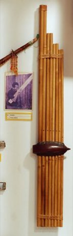

# Khene

*Khene / แคน · Lao bamboo mouth organ*

**Encyclopedia ID 145** (permanent) · https://equalinformation.com/world-heritage-games-site/games/145-khene/

*Photo: Soinuenea - Herri Musikaren Txokoa, [CC BY-SA 2.0](https://creativecommons.org/licenses/by-sa/2.0/), [source on Wikimedia Commons](https://commons.wikimedia.org/wiki/File:Khene.jpg)*

the continuous breath sound loops without pause.

## Heritage note

Part of the living heritage of Laos. Some forms of this practice carry deep meaning for the communities who keep it; here we describe the play and the craft only, with respect for its roots.

## Origins

A living tradition passed from person to person; it is not tied to a single dated origin. It belongs to the cultural world of Southeast Asia and the Islands.

## Facts

- **Where:** Laos
- **Type:** Musical instruments
- **Family:** Wind instruments
- **Era:** [Living Traditions](../../eras/living/index.md)
- **Cradle:** [Southeast Asia and the Islands](../../cradles/southeast-asia/index.md)
- **Region:** East and Southeast Asia

## Related entries

- [Mijwiz Double Clarinet](../../games/221-mijwiz-double-clarinet/index.md)
- [Mudhif reed-arch house](../../games/230-mudhif-reed-arch-house/index.md)
- [Lusheng](../../games/337-lusheng/index.md)
- [Launeddas Triple Pipe](../../games/400-launeddas-triple-pipe/index.md)
- [Rubboard zydeco rhythm](../../games/437-rubboard-zydeco-rhythm/index.md)
- [Cuneiform Clay Tablet Scribe](../../games/1260-cuneiform-clay-tablet-scribe/index.md)

## Sources

- <https://commons.wikimedia.org/wiki/File:Khene.jpg>
