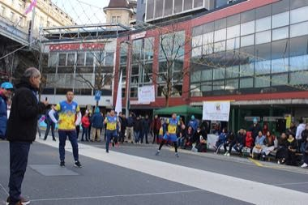

# Ecuavoley

*Ecuavóley*

**Encyclopedia ID 1450** (permanent) · https://equalinformation.com/world-heritage-games-site/games/1450-ecuavoley/

*Photo: SantGalTerEcuavoley, [CC BY-SA 4.0](https://creativecommons.org/licenses/by-sa/4.0/), [source on Wikimedia Commons](https://commons.wikimedia.org/wiki/File:Partido_de_exhibici%C3%B3n,_Olimpiadas_Juveniles_de_invierno,_Lausanne,_2022.jpg)*

Three-a-side net game over a 2.8 m net with a heavy ball: a server, a setter and a flyer; the ball may be held briefly, and teams rally to 15 points.

## Heritage note

Part of the living heritage of Ecuador.

## Origins

A living tradition passed from person to person; it is not tied to a single dated origin. It belongs to the cultural world of The Americas: Andes and South America.

## Facts

- **Where:** Ecuador
- **Type:** Other traditions
- **Family:** Water sports
- **Era:** [Living Traditions](../../eras/living/index.md) (uncertain)
- **Cradle:** [The Americas: Andes and South America](../../cradles/andes-south-america/index.md)
- **Region:** Americas

## Related entries

- [Jangada Sailing](../../games/1413-jangada-sailing/index.md)
- [Faustball](../../games/485-faustball/index.md)
- [Fijiri Pearl-Diver Sea Songs](../../games/1280-fijiri-pearl-diver-sea-songs/index.md)
- [Water Polo Sprint](../../games/1398-water-polo-sprint/index.md)
- [Ice Canoe Race](../../games/1412-ice-canoe-race/index.md)
- [Bequia Boat and Model Builder](../../games/1440-bequia-boat-and-model-builder/index.md)

## Sources

- <https://commons.wikimedia.org/wiki/File:Partido_de_exhibici%C3%B3n,_Olimpiadas_Juveniles_de_invierno,_Lausanne,_2022.jpg>
