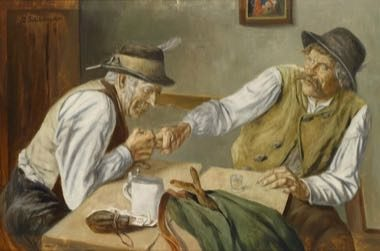

# Finger Hooking

*Fingerhakeln*

**Encyclopedia ID 1452** (permanent) · https://equalinformation.com/world-heritage-games-site/games/1452-finger-hooking/

*Photo: Georg Schildknecht, [Public domain](https://creativecommons.org/publicdomain/mark/1.0/), [source on Wikimedia Commons](https://commons.wikimedia.org/wiki/File:Georg_Schildknecht_Fingerhakeln.jpg)*

Two players hook one finger in a leather loop across a table and try to drag the opponent over.

## Heritage note

Part of the living heritage of Germany, Austria. It is presented as sport and skill, never as real fighting.

## Origins

Usually placed in the era of Classical Worlds (about 1000 BCE to 500 CE), although its exact origins are uncertain, within the cultural world of Northern and Eastern Europe.

## Facts

- **Where:** Germany, Austria
- **Type:** Wrestling and martial sports
- **Family:** Rhyme and hand games
- **Era:** [Classical Worlds](../../eras/classical/index.md) (uncertain)
- **Cradle:** [Northern and Eastern Europe](../../cradles/north-east-europe/index.md)
- **Region:** Europe

## Related entries

- [Morra](../../games/83-morra/index.md)
- [Tuvan Throat Singing](../../games/508-tuvan-throat-singing/index.md)
- [Finger pulling](../../games/563-finger-pulling/index.md)
- [Tavern Nail and Wire Puzzles](../../games/110-tavern-nail-and-wire-puzzles/index.md)
- [Double Dutch](../../games/53-double-dutch/index.md)
- [Mounted Archery Course](../../games/67-mounted-archery-course/index.md)

## Sources

- <https://commons.wikimedia.org/wiki/File:Georg_Schildknecht_Fingerhakeln.jpg>
