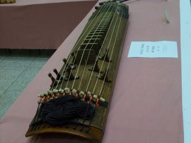

# Geomungo

*Also known as: 거문고 · six-string black-crane zither*

**Encyclopedia ID 1453** (permanent) · https://bpupadhyaya.github.io/world-heritage-games-site/games/1453-geomungo/

*Photo: Visviva, [Public domain](https://creativecommons.org/publicdomain/mark/1.0/), [source on Wikimedia Commons](https://commons.wikimedia.org/wiki/File:Geomungo_11_string.jpg)*

Pluck and strike six silk strings with a bamboo plectrum over 16 raised frets, following falling notes in the deep, resonant style of the geomungo.

## Heritage note

Part of the living heritage of South Korea.

## Origins

Usually placed in the era of Classical Worlds (about 1000 BCE to 500 CE), although its exact origins are uncertain, within the cultural world of Japan and Korea.

## Facts

- **Where:** South Korea
- **Type:** Musical instruments
- **Family:** String instruments
- **Era:** [Classical Worlds](../../eras/classical/index.md) (uncertain)
- **Cradle:** [Japan and Korea](../../cradles/japan-korea/index.md)
- **Region:** East and Southeast Asia

## Related entries

- [Gayageum](../../games/361-gayageum/index.md)
- [Morin khuur](../../games/34-morin-khuur/index.md)
- [Kathputli string puppets](../../games/79-kathputli-string-puppets/index.md)
- [Valiha tube zither](../../games/124-valiha-tube-zither/index.md)
- [Krar lyre](../../games/126-krar-lyre/index.md)
- [Joropo llanero band](../../games/130-joropo-llanero-band/index.md)

## Sources

- <https://commons.wikimedia.org/wiki/File:Geomungo_11_string.jpg>
