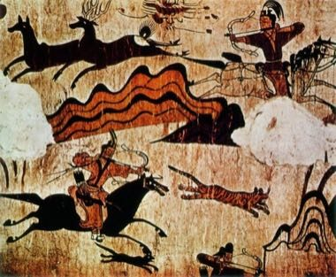

# Goguryeo Mural Restoration

*고구려 고분벽화*

**Encyclopedia ID 1454** (permanent) · https://bpupadhyaya.github.io/world-heritage-games-site/games/1454-goguryeo-mural-restoration/

*Photo: Unknown authorUnknown author, [Public domain](https://creativecommons.org/publicdomain/mark/1.0/), [source on Wikimedia Commons](https://commons.wikimedia.org/wiki/File:Goguryeo_tomb_mural.jpg)*

Reassemble flaked mural fragments of hunting, dance and wrestling scenes on a plaster wall, matching colour, line and pigment before the scene is complete.

## Heritage note

Part of the living heritage of South Korea, North Korea.

## Origins

Usually placed in the era of River Valleys and First Cities (about 3000 to 1000 BCE), although its exact origins are uncertain, within the cultural world of Japan and Korea.

## Facts

- **Where:** South Korea, North Korea
- **Type:** Puzzles and mind games
- **Family:** Puzzle and dexterity toys
- **Era:** [River Valleys and First Cities](../../eras/river-valleys/index.md) (uncertain)
- **Cradle:** [Japan and Korea](../../cradles/japan-korea/index.md)
- **Region:** East and Southeast Asia

## Related entries

- [Dalgona](../../games/100-dalgona/index.md)
- [Hangul syllable blocks](../../games/364-hangul-syllable-blocks/index.md)
- [Polder Windmill Keeper](../../games/412-polder-windmill-keeper/index.md)
- [Windmill Miller](../../games/507-windmill-miller/index.md)
- [Tuho](../../games/1089-tuho/index.md)
- [Kingyo-sukui](../../games/3-kingyo-sukui/index.md)

## Sources

- <https://commons.wikimedia.org/wiki/File:Goguryeo_tomb_mural.jpg>
