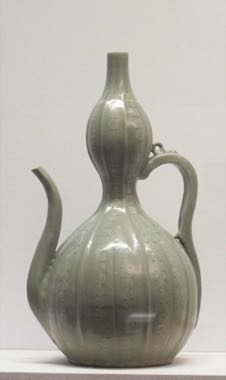

# Goryeo Celadon Inlay

*고려청자 상감 · sanggam*

**Encyclopedia ID 1455** (permanent) · https://equalinformation.com/world-heritage-games-site/games/1455-goryeo-celadon-inlay/

*Photo: Ismoon (talk), [CC BY-SA 4.0](https://creativecommons.org/licenses/by-sa/4.0/), [source on Wikimedia Commons](https://commons.wikimedia.org/wiki/File:Ewer,_celadon_with_inlaid_decoration.Goryeo_Period._Guimet.jpg)*

Incise crane, cloud and chrysanthemum motifs into a green celadon vessel, fill them with white and black slip, and judge the glaze in the kiln for the famous kingfisher-jade colour.

## Heritage note

Part of the living heritage of South Korea, North Korea.

## Origins

A living tradition passed from person to person; it is not tied to a single dated origin. It belongs to the cultural world of Japan and Korea.

## Facts

- **Where:** South Korea, North Korea
- **Type:** Crafts and making
- **Family:** Pottery, wood and metal crafts
- **Era:** [Living Traditions](../../eras/living/index.md)
- **Cradle:** [Japan and Korea](../../cradles/japan-korea/index.md)
- **Region:** East and Southeast Asia

## Related entries

- [Lost-Wax Bronze Casting](../../games/178-lost-wax-bronze-casting/index.md)
- [Leaded Glass Window Making](../../games/501-leaded-glass-window-making/index.md)
- [Ukiyo-e Woodblock Printing](../../games/1490-ukiyo-e-woodblock-printing/index.md)
- [Zellij tile mosaic](../../games/21-zellij-tile-mosaic/index.md)
- [Swahili carved door](../../games/90-swahili-carved-door/index.md)
- [Thai fruit and vegetable carving](../../games/114-thai-fruit-and-vegetable-carving/index.md)

## Sources

- <https://commons.wikimedia.org/wiki/File:Ewer,_celadon_with_inlaid_decoration.Goryeo_Period._Guimet.jpg>
