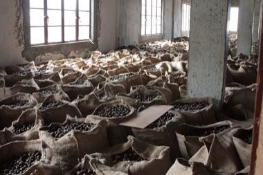

# Grenada Nutmeg Grading

*Nutmeg sorting*

**Encyclopedia ID 1456** (permanent) · https://equalinformation.com/world-heritage-games-site/games/1456-grenada-nutmeg-grading/

*Photo: Paul Harrison, [CC BY-SA 4.0](https://creativecommons.org/licenses/by-sa/4.0/), [source on Wikimedia Commons](https://commons.wikimedia.org/wiki/File:Nutmeg_Collective_Grenada_2009_02.jpg)*

Dry, crack, sort and grade nutmegs and mace by size and quality, then bag them for market.

## Heritage note

Part of the living heritage of Grenada. Some forms of this practice carry deep meaning for the communities who keep it; here we describe the play and the craft only, with respect for its roots.

## Origins

Usually placed in the era of Modern Heritage (1800 to today), although its exact origins are uncertain, within the cultural world of The Americas: Caribbean.

## Facts

- **Where:** Grenada
- **Type:** Puzzles and mind games
- **Family:** Puzzle and dexterity toys
- **Era:** [Modern Heritage](../../eras/modern/index.md) (uncertain)
- **Cradle:** [The Americas: Caribbean](../../cradles/caribbean/index.md)
- **Region:** Americas

## Related entries

- [Limbo](../../games/58-limbo/index.md)
- [Cush](../../games/760-cush/index.md)
- [Street play games](../../games/1155-street-play-games/index.md)
- [Kingyo-sukui](../../games/3-kingyo-sukui/index.md)
- [Stone Skipping](../../games/5-stone-skipping/index.md)
- [Disc-flip](../../games/8-disc-flip/index.md)

## Sources

- <https://commons.wikimedia.org/wiki/File:Nutmeg_Collective_Grenada_2009_02.jpg>
