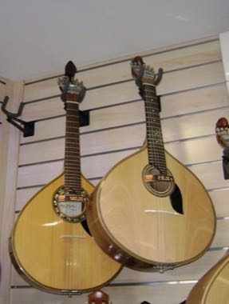

# Portuguese Guitar

*Also known as: Guitarra Portuguesa*

**Encyclopedia ID 1457** (permanent) · https://bpupadhyaya.github.io/world-heritage-games-site/games/1457-portuguese-guitar/

*Photo: TenIslands, [Public domain](https://creativecommons.org/publicdomain/mark/1.0/), [source on Wikimedia Commons](https://commons.wikimedia.org/wiki/File:2_Portuguese_guitars.jpg)*

Pluck paired steel strings in the right rhythm and ornaments to follow a melodic line over a fado song, with strumming and glissando touches.

## Heritage note

Part of the living heritage of Portugal. Some forms of this practice carry deep meaning for the communities who keep it; here we describe the play and the craft only, with respect for its roots.

## Origins

Usually placed in the era of Classical Worlds (about 1000 BCE to 500 CE), although its exact origins are uncertain, within the cultural world of Mediterranean.

## Facts

- **Where:** Portugal
- **Type:** Musical instruments
- **Family:** String instruments
- **Era:** [Classical Worlds](../../eras/classical/index.md) (uncertain)
- **Cradle:** [Mediterranean](../../cradles/mediterranean/index.md)
- **Region:** Europe

## Related entries

- [Morin khuur](../../games/34-morin-khuur/index.md)
- [String Marionette Theatre](../../games/68-string-marionette-theatre/index.md)
- [Kathputli string puppets](../../games/79-kathputli-string-puppets/index.md)
- [Valiha tube zither](../../games/124-valiha-tube-zither/index.md)
- [Krar lyre](../../games/126-krar-lyre/index.md)
- [Joropo llanero band](../../games/130-joropo-llanero-band/index.md)

## Sources

- <https://commons.wikimedia.org/wiki/File:2_Portuguese_guitars.jpg>
