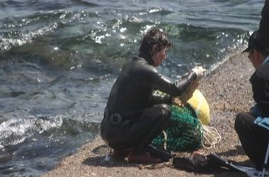

# Haenyeo Breath Dive

*Also known as: 해녀 · Jeju women divers*

**Encyclopedia ID 1459** (permanent) · https://bpupadhyaya.github.io/world-heritage-games-site/games/1459-haenyeo-breath-dive/

*Photo: by karendotcom127, [CC BY 2.0](https://creativecommons.org/licenses/by/2.0/), [source on Wikimedia Commons](https://commons.wikimedia.org/wiki/File:Korea-Jeju-Haenyeo-02.jpg)*

Hold your breath, dive along rope lines, grab abalone, conch and seaweed among the rocks, then surface to breathe before your lungs run out; sell the haul and upgrade nets.

## Heritage note

Part of the living heritage of South Korea. Some forms of this practice carry deep meaning for the communities who keep it; here we describe the play and the craft only, with respect for its roots.

## Origins

Usually placed in the era of Modern Heritage (1800 to today), although its exact origins are uncertain, within the cultural world of Japan and Korea.

## Facts

- **Where:** South Korea
- **Type:** Dexterity and skill games
- **Family:** Water sports
- **Era:** [Modern Heritage](../../eras/modern/index.md) (uncertain)
- **Cradle:** [Japan and Korea](../../cradles/japan-korea/index.md)
- **Region:** East and Southeast Asia

## Related entries

- [Netball](../../games/447-netball/index.md)
- [Pole-and-line tuna fishing from a masdhoni](../../games/1334-pole-and-line-tuna-fishing-from-a-masdhoni/index.md)
- [Voyageur canoe racing](../../games/6366-voyageur-canoe-racing/index.md)
- [Matkot](../../games/825-matkot/index.md)
- [Kataw](../../games/873-kataw/index.md)
- [Mixtec ball game](../../games/936-mixtec-ball-game/index.md)

## Sources

- <https://commons.wikimedia.org/wiki/File:Korea-Jeju-Haenyeo-02.jpg>
