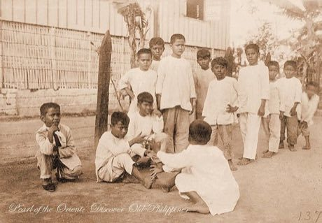

# Luksong tinik

*Luksong tinik · jump the thorns*

**Encyclopedia ID 146** (permanent) · https://bpupadhyaya.github.io/world-heritage-games-site/games/146-luksong-tinik/

*Photo: Thorn Hurdles (Pearl of the Orient: Discover Old Philippines), [Public domain](https://creativecommons.org/publicdomain/mark/1.0/), [source on Wikimedia Commons](https://commons.wikimedia.org/wiki/File:Luksong_Tinik.jpg)*

Two players sit facing each other and stack hands as a rising 'thorn' hurdle while the jumper runs and vaults over it.

## Heritage note

Part of the living heritage of Philippines.

## Origins

Usually placed in the era of Modern Heritage (1800 to today), although its exact origins are uncertain, within the cultural world of Southeast Asia and the Islands.

## Facts

- **Where:** Philippines
- **Type:** Street and playground games
- **Era:** [Modern Heritage](../../eras/modern/index.md) (uncertain)
- **Cradle:** [Southeast Asia and the Islands](../../cradles/southeast-asia/index.md)
- **Region:** East and Southeast Asia

## Related entries

- [Tinikling](../../games/141-tinikling/index.md)
- [Sipa](../../games/1024-sipa/index.md)
- [Tumbang preso](../../games/1028-tumbang-preso/index.md)
- [Chinlone](../../games/16-chinlone/index.md)
- [Lato-lato](../../games/316-lato-lato/index.md)
- [Cublak-cublak suweng](../../games/325-cublak-cublak-suweng/index.md)

## Sources

- <https://commons.wikimedia.org/wiki/File:Luksong_Tinik.jpg>
