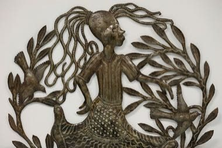

# Haitian Oil-Drum Metal Cut-Out Art

*Fè koupe (Croix-des-Bouquets)*

**Encyclopedia ID 1460** (permanent) · https://equalinformation.com/world-heritage-games-site/games/1460-haitian-oil-drum-metal-cut-out-art/

*Photo: Alex Proimos, [CC BY 2.0](https://creativecommons.org/licenses/by/2.0/), [source on Wikimedia Commons](https://commons.wikimedia.org/wiki/File:Haitian_Metal_Art_(8321093754).jpg)*

Flatten a steel drum, trace a design (birds, trees, dancers, fish), then chisel and hammer the outline and add texture lines before the piece is finished and hung.

## Heritage note

Part of the living heritage of Haiti. Some forms of this practice carry deep meaning for the communities who keep it; here we describe the play and the craft only, with respect for its roots. Animals are partners in this tradition; good care and local rules always come first.

## Origins

A living tradition passed from person to person; it is not tied to a single dated origin. It belongs to the cultural world of The Americas: Caribbean.

## Facts

- **Where:** Haiti
- **Type:** Crafts and making
- **Family:** Drums and percussion
- **Era:** [Living Traditions](../../eras/living/index.md)
- **Cradle:** [The Americas: Caribbean](../../cradles/caribbean/index.md)
- **Region:** Americas

## Related entries

- [Talking drum](../../games/33-talking-drum/index.md)
- [Marimba](../../games/52-marimba/index.md)
- [Calabash Water Drum](../../games/180-calabash-water-drum/index.md)
- [Amadinda and embaire](../../games/185-amadinda-and-embaire/index.md)
- [Tombak goblet drum rhythms](../../games/233-tombak-goblet-drum-rhythms/index.md)
- [Dhol drum rhythm](../../games/263-dhol-drum-rhythm/index.md)

## Sources

- <https://commons.wikimedia.org/wiki/File:Haitian_Metal_Art_(8321093754).jpg>
