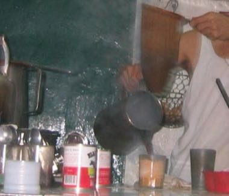

# Hong Kong Milk Tea Pulling

*港式奶茶 (絲襪奶茶)*

**Encyclopedia ID 1463** (permanent) · https://bpupadhyaya.github.io/world-heritage-games-site/games/1463-hong-kong-milk-tea-pulling/

*Photo: K.C. Tang, [CC BY-SA 3.0](https://creativecommons.org/licenses/by-sa/3.0/), [source on Wikimedia Commons](https://commons.wikimedia.org/wiki/File:Making_Hong_Kong_Style_Milk_Tea.JPG)*

Steep black tea leaves in a cloth strainer, pull the tea back and forth between two pots at the right speed, mix evaporated milk, and serve a rush of orders in time.

## Heritage note

Part of the living heritage of China.

## Origins

A living tradition passed from person to person; it is not tied to a single dated origin. It belongs to the cultural world of China.

## Facts

- **Where:** China
- **Type:** Crafts and making
- **Family:** Winter sports
- **Era:** [Living Traditions](../../eras/living/index.md)
- **Cradle:** [China](../../cradles/china/index.md)
- **Region:** East and Southeast Asia

## Related entries

- [Bamboo scaffold builder](../../games/369-bamboo-scaffold-builder/index.md)
- [Neon sign bender](../../games/371-neon-sign-bender/index.md)
- [Dumpling Pleating](../../games/499-dumpling-pleating/index.md)
- [Plate Spinning](../../games/73-plate-spinning/index.md)
- [Wire car](../../games/85-wire-car/index.md)
- [Maple taffy on snow](../../games/441-maple-taffy-on-snow/index.md)

## Sources

- <https://commons.wikimedia.org/wiki/File:Making_Hong_Kong_Style_Milk_Tea.JPG>
