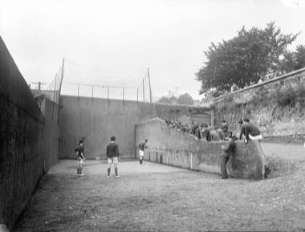

# Irish Handball

*Also known as: Liathróid láimhe · Alley Handball*

**Encyclopedia ID 1464** (permanent) · https://bpupadhyaya.github.io/world-heritage-games-site/games/1464-irish-handball/

*Photo: National Library of Ireland on The Commons, No restrictions, [source on Wikimedia Commons](https://commons.wikimedia.org/wiki/File:Boys_playing_handball_at_a_handball_court_in_Ireland_in_the_1930s_(5774774659).jpg)*

Strike a small rubber ball with your palm against a wall, alternating with your opponent so each shot must hit the front wall before a second bounce.

## Heritage note

Part of the living heritage of Ireland.

## Origins

A living tradition passed from person to person; it is not tied to a single dated origin. It belongs to the cultural world of Celtic and Atlantic Europe.

## Facts

- **Where:** Ireland
- **Type:** Crafts and making
- **Era:** [Living Traditions](../../eras/living/index.md)
- **Cradle:** [Celtic and Atlantic Europe](../../cradles/celtic-atlantic/index.md)
- **Region:** Europe

## Related entries

- [Celtic knot weave](../../games/25-celtic-knot-weave/index.md)
- [Tartan Sett Weaving](../../games/505-tartan-sett-weaving/index.md)
- [Bobbin lace making](../../games/108-bobbin-lace-making/index.md)
- [Hurdy-gurdy](../../games/153-hurdy-gurdy/index.md)
- [Nordic Colourwork Knitting](../../games/413-nordic-colourwork-knitting/index.md)
- [Welsh Love Spoon Carving](../../games/414-welsh-love-spoon-carving/index.md)

## Sources

- <https://commons.wikimedia.org/wiki/File:Boys_playing_handball_at_a_handball_court_in_Ireland_in_the_1930s_(5774774659).jpg>
