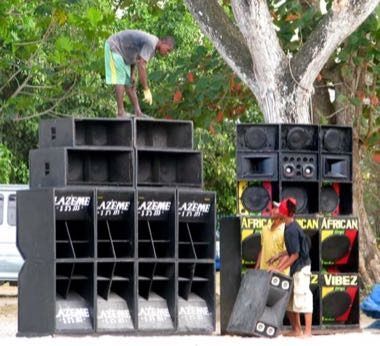

# Jamaican Sound System Selector

*Also known as: Sound system*

**Encyclopedia ID 1465** (permanent) · https://bpupadhyaya.github.io/world-heritage-games-site/games/1465-jamaican-sound-system-selector/

*Photo: Dubdem e FabDub, [CC BY 2.0](https://creativecommons.org/licenses/by/2.0/), [source on Wikimedia Commons](https://commons.wikimedia.org/wiki/File:Sound_System.jpg)*

As the selector, pick records from a crate, cue them and cross-fade between two turntables, then add a toast over the beat to keep the crowd dancing in a street dance.

## Heritage note

Part of the living heritage of Jamaica.

## Origins

Usually placed in the era of Modern Heritage (1800 to today), although its exact origins are uncertain, within the cultural world of The Americas: Caribbean.

## Facts

- **Where:** Jamaica
- **Type:** Musical instruments
- **Family:** Folk and line dances
- **Era:** [Modern Heritage](../../eras/modern/index.md) (uncertain)
- **Cradle:** [The Americas: Caribbean](../../cradles/caribbean/index.md)
- **Region:** Americas

## Related entries

- [Spinning top](../../games/678-spinning-top/index.md)
- [Dabke line dance](../../games/37-dabke-line-dance/index.md)
- [Limbo](../../games/58-limbo/index.md)
- [Gumboot dance rhythm](../../games/123-gumboot-dance-rhythm/index.md)
- [Tahtib](../../games/157-tahtib/index.md)
- [Eskista](../../games/188-eskista/index.md)

## Sources

- <https://commons.wikimedia.org/wiki/File:Sound_System.jpg>
