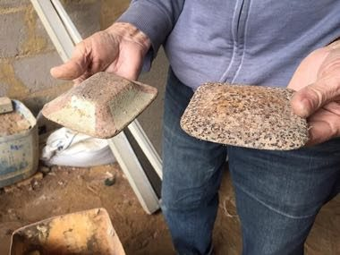

# Malha

*Jogo da Malha · Portuguese Metal Disc Toss*

**Encyclopedia ID 1466** (permanent) · https://bpupadhyaya.github.io/world-heritage-games-site/games/1466-malha/

*Photo: Lucasbrivilato, [CC BY-SA 4.0](https://creativecommons.org/licenses/by-sa/4.0/), [source on Wikimedia Commons](https://commons.wikimedia.org/wiki/File:Jogo_da_Malha.jpg)*

Slide or throw a flat metal disc 18 m to knock down a wooden pin (meco), earning points for distance and for toppling it.

## Heritage note

Part of the living heritage of Portugal. Animals are partners in this tradition; good care and local rules always come first.

## Origins

Usually placed in the era of Classical Worlds (about 1000 BCE to 500 CE), although its exact origins are uncertain, within the cultural world of Mediterranean.

## Facts

- **Where:** Portugal
- **Type:** Archery, throwing and target games
- **Family:** Winter sports
- **Era:** [Classical Worlds](../../eras/classical/index.md) (uncertain)
- **Cradle:** [Mediterranean](../../cradles/mediterranean/index.md)
- **Region:** Europe

## Related entries

- [Kottabos Symposium Toss](../../games/392-kottabos-symposium-toss/index.md)
- [Barrel racing](../../games/439-barrel-racing/index.md)
- [Skijoring](../../games/490-skijoring/index.md)
- [Ring Tilting](../../games/65-ring-tilting/index.md)
- [Gondola Rowing](../../games/401-gondola-rowing/index.md)
- [Crossbow Target Match](../../games/1367-crossbow-target-match/index.md)

## Sources

- <https://commons.wikimedia.org/wiki/File:Jogo_da_Malha.jpg>
